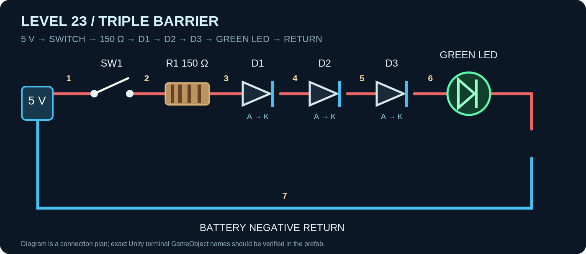

# PROJECT SPARK — LEVEL 23 UNITY CREATION PROCESS
**Level:** Triple Barrier — Three Diodes in Series  
**Mission:** Build a 5 V circuit with three forward-biased 1N4007 diodes, a 150 Ω resistor, and a green LED.  
**Completion:** 6/6 targets  
**Scope:** Level 23 content only. No shared SparkElectricalSolver modifications.

## Circuit image

## Step-by-step Unity setup

### 01 — Backup the working project
Save a copy or commit of the working Level 22 prefab, corrected SparkDiodeSolverDefinition, stable SparkElectricalSolver, and Level 21 transient driver. Do not edit shared solver code for this level.

### 02 — Duplicate Level 22
In Project view, duplicate Level_22_Layout prefab into Level_23_Layout. Duplicate the Level_22 definition asset into Level_23.asset if not already created. Keep the old assets untouched.

### 03 — Import Level 23 definition
Select the ORIGINAL Level_23.asset in Unity, then import Level_23_Triple_Diode_Fixed.txt with your editable ScriptableObject importer. Confirm levelId=level_23, displayName=Triple Barrier - Three Diodes in Series, and requiredTargetCount=6.

### 04 — Link prefab and catalog
On Level_23_Layout > SparkLevelLayout, assign Level_23.asset. On SparkLevelLayoutCatalog, add the new definition/layout pair. Add Level_23.asset to LevelGamePlayManager.levels[] (index 22, for 23 levels). Do not assume catalog registration updates manager array. Use development unlock if needed.

### 05 — Build components
Set power supply to 5 V. Reuse Power_Switch. Put a 150 Ω resistor in Slot_01, three separate 1N4007 diode items in Slot_02, Slot_03, and Slot_04. The three diode components must be distinct instances. Put the green LED in a fixed scene location (preferred), not a shelf-managed workstation.

### 06 — Set diode orientation
For every diode, anode must face the previous component, and banded cathode must face the next component/LED. Assign each SparkDiode.AnodeTerminal and CathodeTerminal to the corresponding SparkTerminal objects. The LED anode faces D3 cathode; LED cathode faces battery negative.

### 07 — Configure workstation bindings
On Slot_01/02/03/04 set SparkShelfSlot Kind=Workstation, matching category, occupied-at-start if preinstalled, and appropriate RuntimeComponentId/RuntimeTerminalAId/RuntimeTerminalBId. Set SparkShelfItem category and preferred workstation correctly. Ensure bridge Smart Slots setting agrees with the slot approach; do not mix conflicting runtime IDs.

### 08 — Configure fixed LED scene bindings
In SparkLevelSceneBindings, bind component ID led to the actual SparkLED component and terminal IDs LED_Anode and LED_Cathode to its real terminals. These are the IDs in the currently exported Level 23 definition. Do not add an empty LED workstation rule that tries to overwrite them.

### 09 — Connect seven external wires
Use the seven connections in the wiring checklist. The physical wires bridge adjacent components; the component solver definitions handle conduction internally. Verify each connection in SparkCircuitSystem, not only by glow.

### 10 — Verify solver definitions
Keep the already corrected diode Stamp() that calls AddForwardDrop(anode, cathode, ForwardVoltage, resistance) exactly once; AddForwardDrop internally stamps conductance. Confirm each diode uses the registered SparkDiodeSolverDefinition, and LED uses the registered LED solver definition.

### 11 — Verify bindings and current
In Play Mode press Synchronize + Report Now and confirm all 12 workstation IDs bind (3 resistor + 9 diodes). Confirm fixed LED resolves directly. Close switch and run the solved-source-current audit. Test with all components connected.

### 12 — Tune and complete
Check 6/6 objectives. Record measured diode drops and resistor current; if necessary adjust only Level_23.asset thresholds, not the shared solver. Confirm Level 22 remains 4/4 and Level 21 charges normally.

## Seven external wire connections

| # | From | To |
|---|---|---|
| 1 | `Battery_positive` | `SwitchInput` |
| 2 | `SwitchOutput` | `Register_Input` |
| 3 | `Register_Output` | `Diode1_Anode` |
| 4 | `Diode1_Cathode` | `Diode2_Anode` |
| 5 | `Diode2_Cathode` | `Diode3_Anode` |
| 6 | `Diode3_Cathode` | `LED_Anode` |
| 7 | `LED_Cathode` | `Battery_negative` |

## Replaceable workstation runtime IDs

| Slot | Component binding | Terminal A | Terminal B |
|---|---|---|---|
| `Slot_01` | `R_LIMIT_Component` | `R_LIMIT_Input` | `R_LIMIT_Output` |
| `Slot_02` | `D_SERIES_1_Component` | `D_SERIES_1_Anode` | `D_SERIES_1_Cathode` |
| `Slot_03` | `D_SERIES_2_Component` | `D_SERIES_2_Anode` | `D_SERIES_2_Cathode` |
| `Slot_04` | `D_SERIES_3_Component` | `D_SERIES_3_Anode` | `D_SERIES_3_Cathode` |

**Fixed LED scene bindings:** `led`, `LED_Anode`, `LED_Cathode`. Be careful: the Level 23 definition currently uses these exact IDs, not `LED_INDICATOR_*`.

## Six target definitions

| Target ID | Type | Requirement |
|---|---|---|
| `level23_supply` | VoltageRange | 4.8–5.2 V |
| `level23_diode1` | VoltageRange | 0.45–1.0 V |
| `level23_diode2` | VoltageRange | 0.45–1.0 V |
| `level23_diode3` | VoltageRange | 0.45–1.0 V |
| `level23_led_on` | LEDOn | ON |
| `level23_safe_current` | CurrentRange | 4.5–6.5 mA |

## Electrical predictions (theory, not verified solved results)
Assuming three diode drops of 0.7 V and an LED drop of 2.1 V: `I = (5 - 3×0.7 - 2.1) / 150 = 0.00533 A` (~5.33 mA). Each diode should be approximately 0.7 V and resistor approximately 0.8 V. Actual solver results may differ.

## Validation checklist
- [ ] Level_23.asset has levelId `level_23` and 6 objectives
- [ ] Catalog and manager array contain Level 23
- [ ] Four occupied resistor/diode workstations and all 12 runtime bindings resolve
- [ ] Fixed LED direct scene bindings resolve with exact IDs
- [ ] Seven wires are present, switch closed, both source terminals connected
- [ ] Diode anode/cathode directions verified on all three diodes
- [ ] Corrected diode AddForwardDrop stamp used; no duplicate conductance
- [ ] Solver success, positive source current, resistor current within target
- [ ] No source short, target short or open return; 6/6 completes
- [ ] Level 22 remains 4/4; Level 21 transient charging still works

## Troubleshooting
**UNBOUND D_SERIES_*:** check preinstalled SparkShelfItem occupant, slot/runtime IDs, bridge Smart Slots mode, and actual diode terminal names.
**LED UNBOUND:** fixed binding IDs `led`, `LED_Anode`, `LED_Cathode` must match Level_23.asset. Do not rely on an empty LED workstation.
**Source current 0 A / ClosedReturn NO:** check seven real SparkCircuitSystem connections, switch closed, diode/LED polarity, and success of nonlinear solve.
**Solver nonconvergent when diode connected:** confirm diode model calls `AddForwardDrop(..., onResistance)` once (not conductance) without separate AddConductance.
**Level not loading:** check `LevelGamePlayManager.levels[]` index 22 and progression access, separately from layout catalog.
**Performance:** keep the stable dirty-based solver; no global continuous tick; gate debug messages.
**Teaching drawing:** native `SparkLevelDrawingAsset` creator can be authored as a separate Level 23 asset with overview, wiring, forward drops and target pages; this guide does not claim to generate that Unity asset.